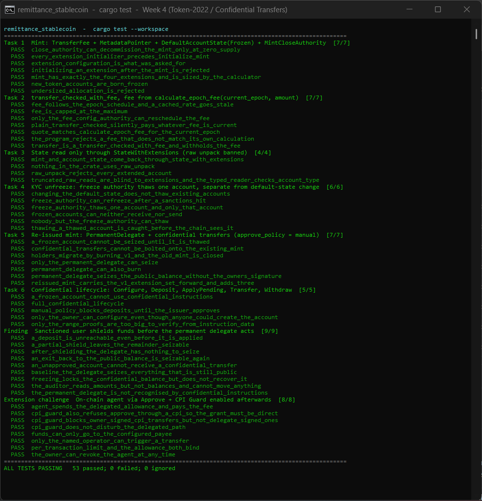

# Remittance stablecoin on Token-2022

A remittance stablecoin built from Token-2022 extensions, with the full lifecycle exercised by an
automated test suite: **53 tests, all passing**, including real zero-knowledge proofs for
confidential transfers. This is the Week 4 assignment (Token-22 / Confidential Transfers).



*A real terminal running `scripts/test-report.ps1`, which runs `cargo test --workspace` and groups
every test under the assignment task it covers. The raw cargo output is in
[`docs/test-output.txt`](docs/test-output.txt).*

## Contents

- [Quick start](#quick-start)
- [What the issuer gets](#what-the-issuer-gets)
- [Assignment to code map](#assignment-to-code-map)
- [Task notes](#task-notes)
- [How a confidential transfer runs](#how-a-confidential-transfer-runs)
- [Things that surprised me](#things-that-surprised-me)
- [Limits of this work](#limits-of-this-work)
- [Written finding](#written-finding)
- [Layout and rebuilding the fixtures](#layout-and-rebuilding-the-fixtures)

## Quick start

```bash
cargo test            # 53 tests, ~25 s once built
```

```powershell
pwsh scripts/test-report.ps1   # same run, grouped by assignment task, + docs/test-output.txt
```

Requirements:

- **Rust 1.98.0.** `rust-toolchain.toml` pins it, because the current Solana 4.x crates need
  Rust 1.97 or newer. `rustup` installs it automatically.
- Nothing else. The tests run in-process on [LiteSVM](https://github.com/LiteSVM/litesvm), which
  bundles Token-2022 11.0.0 and the ZK ElGamal Proof program. No validator, no network.
- The Solana CLI is only needed to *rebuild* the two on-chain fixtures (see the end).

The first build takes several minutes: dependencies are compiled with `opt-level = 3`
(`[profile.dev.package."*"]`) because zero-knowledge proof generation is unusably slow unoptimised.

## What the issuer gets

| Need | Mechanism |
|---|---|
| Revenue on every transfer | `TransferFeeConfig`: 1% (100 bps), capped at 2.5 tokens |
| New accounts frozen until KYC clears | `DefaultAccountState(Frozen)` + a freeze authority that thaws per account |
| Wallets need not trust an off-chain registry | `MetadataPointer` pointing at the mint itself, metadata stored in the mint account |
| Decommission the mint | `MintCloseAuthority`, closable only at zero supply |
| Seize from sanctioned wallets (re-issued mint) | `PermanentDelegate` |
| Hidden transfer amounts (re-issued mint) | `ConfidentialTransferMint` with `approve_policy = manual`, plus `ConfidentialTransferFeeConfig` |

## Assignment to code map

| # | Task | Code | Tests |
|---|---|---|---|
| 1 | Stacked-extension mint, sized by `try_calculate_account_len`, init ordered before `InitializeMint` | [`src/mint.rs`](src/mint.rs) | [`task1_mint.rs`](tests/task1_mint.rs) (7) |
| 2 | `transfer_checked_with_fee`, fee from `calculate_epoch_fee(current_epoch, amount)` | [`src/transfer.rs`](src/transfer.rs) | [`task2_transfer_fee.rs`](tests/task2_transfer_fee.rs) (7) |
| 3 | State read only through `StateWithExtensions` | [`src/state.rs`](src/state.rs) | [`task3_state.rs`](tests/task3_state.rs) (4) |
| 4 | Freeze authority thaws one account, separate from default-state change | [`src/kyc.rs`](src/kyc.rs) | [`task4_kyc.rs`](tests/task4_kyc.rs) (6) |
| 5 | Re-issue with `PermanentDelegate` + confidential transfers (manual) | [`src/mint.rs`](src/mint.rs), [`src/seizure.rs`](src/seizure.rs) | [`task5_reissue.rs`](tests/task5_reissue.rs) (7) |
| 6 | Full confidential lifecycle | [`src/confidential.rs`](src/confidential.rs), [`src/record.rs`](src/record.rs), [`src/accounts.rs`](src/accounts.rs) | [`task6_confidential.rs`](tests/task6_confidential.rs) (5) |
| Finding | Sanctioned user shields before the delegate acts | the above | [`task7_sanctions_gap.rs`](tests/task7_sanctions_gap.rs) (9) |
| Challenge | Agent program via `Approve`, then CPI Guard | [`programs/agent`](programs/agent/src/lib.rs) | [`extension_challenge.rs`](tests/extension_challenge.rs) (8) |

The library is an **off-chain client**: it builds instructions and zero-knowledge proofs and reads
state. It never signs or sends. Anything that needs chain state asks a small
[`ChainReader`](src/chain.rs) trait (account bytes plus the current epoch), so the same code works
against LiteSVM here and against an RPC client in an application.

## Task notes

### 1. The mint

`mint::create_mint_v1` emits, in order:

```text
CreateAccount (space = try_calculate_account_len, lamports = rent for space + metadata)
InitializeTransferFeeConfig
InitializeMetadataPointer        metadata_address = the mint itself
InitializeDefaultAccountState    Frozen
InitializeMintCloseAuthority
InitializeMint2                  freeze authority set
InitializeTokenMetadata          + one UpdateField per extra key
```

- **Ordering is tested twice.** A structural test asserts every initializer precedes
  `InitializeMint2`; a negative test moves `InitializeMint2` forward and shows the chain rejects it.
- **Sizing is tested twice.** The final account length equals the calculator's figure plus the
  metadata, and an allocation that leaves out one extension is rejected.
- `TokenMetadata` is variable-length, so `try_calculate_account_len` cannot include it. The account
  is allocated for the fixed extensions and funded for the metadata, which Token-2022 reallocs in.
- **Decommissioning is real.** `close_authority_can_decommission_the_mint_only_at_zero_supply`
  moves tokens (leaving withheld fees behind), shows the close fails while supply is non-zero,
  harvests and withdraws the fees, burns everything, then closes the mint (the account is gone and its lamports are returned).

### 2. Fee-aware transfers

`transfer::transfer_with_fee` reads the source account to find the mint, reads the mint's current
fee schedule, prices the amount with `calculate_epoch_fee(current_epoch, amount)` and emits
`transfer_checked_with_fee`. Nothing caches a rate.

The fee schedule keeps an `older` and a `newer` entry, and a change only takes effect from the
`newer` entry's epoch. `fee_follows_the_epoch_schedule_and_a_cached_rate_goes_stale` shows the
failure mode: a fee priced before a rate change is rejected with `FeeMismatch` after the epoch
rolls over, while the freshly computed one succeeds.

### 3. State reads

Every read goes through `StateWithExtensions::unpack`. The test suite also proves *why*:

- a raw `Mint::unpack` / `Account::unpack` rejects every extended account (wrong length);
- truncating to the base length "works" but is blind to every extension;
- `StateWithExtensions` also checks the account-type byte, so a token account can never be read as
  a mint.

`nothing_in_the_crate_uses_raw_unpack` is a lint-as-a-test: it scans `src/`, `tests/` and
`programs/` and fails on any raw unpack (comments are skipped; the one file that demonstrates the
failure is exempt).

### 4. The KYC path

`kyc::thaw_after_kyc` thaws a single account; `kyc::set_default_account_state` changes how
*future* accounts are born. They are different instructions with different blast radius, and the
tests pin that down: after the default is flipped to `Initialized`, an account that already existed
is still frozen, and flipping it back leaves already-open accounts open. Thaw is refused for the
account owner, the mint authority, the metadata authority and the permanent delegate; changing the
default state is refused for an unrelated signer.

### 5. The re-issue, and the gap

Confidential transfers cannot be added to a live mint; the tests confirm Token-2022 refuses with
`AlreadyInUse`. So `mint::create_mint_v2` creates a **new mint** carrying the v1 set forward and
adding three extensions. A test migrates a holder (burn on v1, mint on v2, close v1).

The gap between the two requirements is that `PermanentDelegate` reaches only the public balance,
while confidential balances are ciphertext only the owner can move. That is the subject of the
[written finding](#written-finding).

### 6. The confidential lifecycle

```text
anyone ──► create ATA                         permissionless; account is born FROZEN
owner  ──► Reallocate + ConfigureAccount      owner signature + PubkeyValidity proof
issuer ──► ApproveAccount                     approve_policy = manual
issuer ──► ThawAccount                        KYC
owner  ──► DepositConfidentialTokens          public ──► pending
owner  ──► ApplyPendingBalance                pending ──► available
owner  ──► confidential Transfer              five proofs, with fee
owner  ──► ApplyPendingBalance                (receiver)
owner  ──► Withdraw                           available ──► public
```

`full_confidential_lifecycle` runs all of it and checks the numbers at each step: after the deposit
the public balance is 0 and the *pending* balance decrypts to 100; the transfer drops the sender's
available balance by the gross amount and credits the receiver's pending balance with the net;
the auditor decrypts the transferred amount; the withdraw planner refuses until pending balance is applied (its proofs are built from the
*available* balance, which excludes pending credits);
conservation holds at the end (everything is either in a public balance or is the withheld fee).

Other tests pin the two distinctions the assignment calls out:

- **`ConfigureAccount` is owner-only, ATA creation is not.** The fee payer creates both users'
  accounts, and a freshly created account has no confidential extension at all. An attacker, the
  permanent delegate, the freeze authority and the confidential-transfer authority all fail to
  configure someone else's account with `OwnerMismatch`.
- **Manual approval is enforced.** Configured-but-unapproved accounts cannot deposit or receive.

## How a confidential transfer runs

A confidential transfer is not one transaction. Proof data is too large to ride along with the
transfer, so each proof is verified first by the ZK ElGamal Proof program, which writes a small
*context state account*; the token instruction then points at those accounts.

The mint charges a transfer fee, so Token-2022 requires the **fee** variant: five proofs, not
three.

| Proof | Size | Verified from |
|---|---:|---|
| CiphertextCommitmentEquality | 320 B | instruction data |
| BatchedGroupedCiphertext3HandlesValidity | 544 B | instruction data |
| PercentageWithCap (fee sigma) | 360 B | instruction data |
| BatchedGroupedCiphertext2HandlesValidity | 416 B | instruction data |
| BatchedRangeProofU256 | 1064 B | **Record account** (does not fit a transaction at all) |
| BatchedRangeProofU64 (Withdraw only) | 936 B | **Record account** |

The Record program ([`src/record.rs`](src/record.rs)) stages the big proofs across several
transactions, then the account is closed. Result for the transfer in the lifecycle test:
**9 setup transactions, 1 transfer transaction (45,409 compute units), 1 cleanup transaction.**

The test harness asserts every transaction fits the 1232-byte packet limit, so a run that passes
here would not be rejected for size on a real cluster. The library only *plans* this work
(`confidential::Plan` is a list of steps and the keypairs each needs); the caller signs and sends.

Keys are derived the standard way (sign the canonical message once, HKDF over the signature), which
the zk-sdk documents as matching what the other Token-2022 clients derive for the same wallet. That
is not checked against another client here.

## Things that surprised me

These came from running the code, and some contradicted what I assumed first.

1. **A plain `TransferChecked` is *not* refused on a fee mint.** The program computes the fee and
   applies it silently. `transfer_checked_with_fee` matters because it makes the fee an *asserted*
   part of the instruction: after a rate change a plain transfer pays the new rate with no
   warning, while the with-fee form fails with `FeeMismatch`.
   (`plain_transfer_checked_silently_pays_whatever_fee_is_current`.)
2. **The confidential extension needs a second, unlisted extension.** A mint with `TransferFeeConfig`
   rejects a fee-less confidential transfer, so the re-issued mint must also carry
   `ConfidentialTransferFeeConfig` (with the withdraw-withheld ElGamal key). The mint has to be
   designed for this up front; it cannot be added later either.
3. **`TokenMetadata::tlv_size_of()` over-counts by 8 bytes** for a Token-2022 account: it uses the
   generic 12-byte TLV header while Token-2022 stores a 4-byte one. `mint_layout` corrects for it
   and a test pins the exact final length.
4. **An ATA is not sized for confidential transfers.** It only gets the extensions the mint
   mandates on accounts, so `ConfigureAccount` must be preceded by `Reallocate`, which only the
   owner can sign.
5. **`DefaultAccountState(Frozen)` interacts with everything.** A frozen account cannot deposit,
   apply, withdraw, transfer, *or be seized*: Token-2022 checks the frozen flag before the
   authority. Seizing from a frozen account needs the freeze authority to thaw it first.
6. **Seizure pays the fee.** It is a transfer, so the treasury receives `amount - fee`.
7. **The range proof is bigger than a transaction.** The 256-bit range proof is 1064 bytes, which
   is why the Record program is in this repo at all.

## Limits of this work

- **Not run on a live cluster.** Everything runs in LiteSVM. The ZK ElGamal Proof program was
  temporarily disabled on public clusters in 2025; check its status on your target cluster before
  relying on confidential transfers.
- **Confidential fee collection is not implemented.** Fees on confidential transfers accrue as
  ciphertext; `HarvestWithheldTokensToMint` and the confidential withdraw-withheld flow are not
  built here. Public fees are collected and tested.
- **Only the fee-bearing confidential `Transfer` path** is built, since the mint always has a fee.
- The agent program (challenge) is a minimal illustration, not an audited design.
- Written-finding claims marked *(source)* come from reading the Token-2022 program, not from a
  test.

## Written finding

[`docs/WRITTEN_FINDING.md`](docs/WRITTEN_FINDING.md) answers: *what happens if a sanctioned user
moves their balance into the confidential system before the permanent delegate acts?*

In short: the permanent delegate only reaches the public balance, so a user who shields in time puts
funds where only the owner can move them. The issuer's remaining levers are refusing approval,
**freezing in place**, and reading amounts through the auditor key. Seizure becomes a freeze. Every
step is backed by a test in [`tests/task7_sanctions_gap.rs`](tests/task7_sanctions_gap.rs).

A ready-to-post version for X / LinkedIn is in [`docs/PUBLISH_DRAFT.md`](docs/PUBLISH_DRAFT.md).

## Extension challenge

[`programs/agent`](programs/agent/src/lib.rs) is a small on-chain program that spends a user's
**delegated** allowance:

1. the user calls `Init` (sets the operator, the only allowed payee and a per-transaction cap) and
   a direct Token-2022 `ApproveChecked` naming the program's config PDA as delegate;
2. the operator calls `Execute`; the program CPIs `transfer_checked_with_fee`, signed by the PDA,
   computing the fee on chain with `calculate_epoch_fee`.

The user then enables **CPI Guard** and the identical `Execute` instruction (asserted byte for byte)
still works. A contrast instruction, `OwnerPull`, moves the *owner's* funds using the owner's
signature inside a CPI: it works until CPI Guard is on and is then refused with
`CpiGuardTransferBlocked`. That is the point of the guard: it stops owner-signed CPIs and leaves
delegate-signed ones alone. More tests cover the agent's own rules (named operator, fixed payee,
per-tx cap, allowance exhaustion, revocation).

## Layout and rebuilding the fixtures

```text
src/
  mint.rs            Task 1, 5: mint builders (v1, v2), layout, ordering check
  transfer.rs        Task 2: fee quote + transfer_checked_with_fee
  state.rs           Task 3: StateWithExtensions views of mints and accounts
  kyc.rs             Task 4: thaw, freeze, default account state
  seizure.rs         Task 5: permanent delegate transfer / burn
  confidential.rs    Task 6: keys, configure, approve, deposit, apply, transfer, withdraw
  record.rs          SPL Record client (stages the proofs that do not fit a transaction)
  accounts.rs        ATA helpers
  chain.rs           ChainReader trait
programs/agent/      extension challenge: on-chain agent (builds to fixtures/agent_program.so)
tests/               one file per task, plus common/ harness
fixtures/            agent_program.so, spl_record.so (prebuilt, loaded by the tests)
scripts/             build-fixtures.ps1, test-report.ps1
docs/                WRITTEN_FINDING.md, PUBLISH_DRAFT.md, tests-passing.png, test-output.txt
```

`fixtures/*.so` are committed so `cargo test` works with nothing but Rust. To audit or refresh
them (needs the Solana CLI for `cargo build-sbf`):

```powershell
pwsh scripts/build-fixtures.ps1
```

It builds `programs/agent`, and builds `spl-record` 0.4.0 **from the published crate source**
rather than trusting a binary. The output is reproducible: rebuilding gave byte-identical files
(94,928 and 27,592 bytes).
